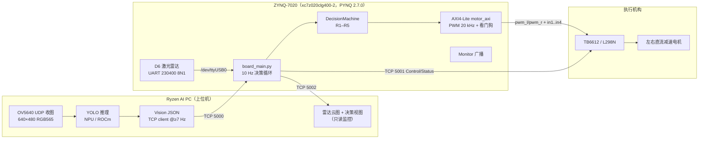

# amd_avoid_car · AMD FPGA 视觉 + 激光雷达协同避障小车

> **2026 全国大学生嵌入式芯片与系统设计竞赛 · AMD 赛道 · 具身智能赛道（指南 3.2）**
> 三人团队：融合决策 / 视觉感知 / FPGA 与电机。
> **私有仓库**：仅两名成员可读写（见 [CONTRIBUTING.md](CONTRIBUTING.md)）。

**一句话**：Ryzen AI PC 跑端侧视觉推理，ZYNQ-7020 板卡跑 360° 激光雷达解析、多传感器融合决策、AXI 电机控制与监控广播；两端通过 TCP 闭环，小车在真实场地完成「看见人/障碍 → 减速 / 绕行 / 停车」的物理任务。

---

## 1. 现状（截至 2026-10-31）

| 层 | 状态 | 证据 / 入口 |
|---|---|---|
| 视觉采集（OV5640 → RGB565 → 千兆 UDP） | ✅ 已上板 | [`fpga/src/vision`](fpga/src/vision)、[`host/app/vision_pc`](host/app/vision_pc) |
| 视觉 FPGA 工程综合实现 | ✅ 时序收敛 | [`fpga/report`](fpga/report)：LUT 2.19%、FF 1.07%、WNS **+1.096 ns** @ 50 MHz |
| 端侧推理（YOLO，Vitis AI EP on AMD NPU） | ✅ 单机跑通 | [`host/app/vision_pc/ryzenai`](host/app/vision_pc/ryzenai) |
| D6 激光雷达协议解析 | ✅ 实测校验 | 1107 帧 / 85 B 从 97022 B 抓包解析通过；[`host/app/d6_tools`](host/app/d6_tools) |
| 融合决策状态机（R1–R5） | ✅ 单元测试 | 32 个测试全过（`python -m pytest car -q`） |
| 三端 TCP 联调（视觉/决策/电机） | ✅ 假硬件全链路 | [`host/app/joint`](host/app/joint)、[`host/app/integration`](host/app/integration) |
| **真车闭环 / 真实场地** | ❌ 未做 | 缺硬件与场地，见 §7 |
| **AI PC 侧接入 ROCm 栈** | ⚠️ 未达成 | 当前是 onnxruntime + Vitis AI EP；3.2.3.1 要求 ROCm ≥ 7.14.0 |

---

## 2. 系统结构



- **分工依据**：视觉推理吃 matrix/DSP 且模型会换 → 放 AI PC；360° 雷达 163 Hz 点云、20 kHz PWM、看门狗急停要求确定性时序 → 放 PL/PS。详见 [`docs/architecture.md`](docs/architecture.md)。
- **三端口**：5000 视觉进、5001 控制出（Status 回显 `seq`）、5002 监控广播（只读）。协议细节见 [`docs/interface.md`](docs/interface.md)。
- **决策时标**：雷达 163 Hz → 10 Hz 决策 → 视觉要求 ≥7 Hz（`vision_timeout_ms=300` 的硬约束，2 Hz 会让 70% 周期在停车）。

---

## 3. 目录（对照指南 3.2.5.5）

官方推荐结构非强制，但本仓库按它对齐，一一对应如下：

| 3.2.5.5 推荐 | 本仓库 | 内容 |
|---|---|---|
| `README.md` | [`README.md`](README.md) | 简介 + 复现步骤 + 目录对照 |
| `docs/architecture.md` | [`docs/architecture.md`](docs/architecture.md) | 架构图、数据流图、模块说明 |
| `docs/interface.md` | [`docs/interface.md`](docs/interface.md) | 协议、报文、寄存器映射、时序约定 |
| `docs/hardware_setup.md` | [`docs/hardware_setup.md`](docs/hardware_setup.md) | 传感器/执行器清单、接线、供电 |
| `fpga/src/` | [`fpga/src`](fpga/src) | OV5640 UDP 视觉链路 RTL + motor AXI（Verilog） |
| `fpga/build/` | [`fpga/build`](fpga/build) | Vivado 构建脚本（tcl）+ 产物说明 |
| `fpga/report/` | [`fpga/report`](fpga/report) | 综合/实现报告：资源、时序、WNS、功耗 |
| `host/model/` | [`host/model`](host/model) | 模型来源、精度、导出与量化脚本、`MODEL.md` |
| `host/app/` | [`host/app`](host/app) | 决策包 `car/`、板上入口 `joint/`、集成层 `integration/`、雷达台 `radar_console/` |
| `host/deploy/` | [`host/deploy`](host/deploy) | 依赖清单、板端/PC 端启动脚本、烧卡工具 |
| `metrics/metrics.csv` | [`metrics/metrics.csv`](metrics/metrics.csv) | 指标汇总表（指南规定表头） |
| `metrics/logs/` | [`metrics/logs`](metrics/logs) | 原始日志（15 份，含假硬件联调与单测运行） |
| `metrics/scripts/` | [`metrics/scripts`](metrics/scripts) | 可重跑的测试脚本 |
| `metrics/evidence/` | [`metrics/evidence`](metrics/evidence) | 波形/示波器/逻辑分析仪截图位 |
| `skill/` | [`skill/README.md`](skill/README.md) | 可复用 Skill 与工作流（加分项） |
| `report/` | [`report/README.md`](report/README.md) | 设计报告（含失败分析与复现说明） |

历史资料（改造方案、交接文档、手册抽取）保留在 [`docs/legacy`](docs/legacy) 与 [`docs/refs`](docs/refs)，文件名已改成纯英文。

---

## 4. 五分钟跑起来（不需要任何硬件）

```bash
# 1) 环境：Python 3.9+（板上是 3.6.9，代码保持 3.6 兼容）
python -m pip install -r host/deploy/requirements-host.txt

# 2) 单元测试：融合决策 + 雷达解析 + 官方帧样本
cd host/app && python -m pytest car -q        # 期望：32 passed

# 3) 契约自检：steering → 差速 PWM、检测框 → Vision JSON
cd host/app/integration && python contract.py

# 4) 全链路（三个进程：假电机 5001 / 板入口 / 假视觉 5000）
cd host/app && bash joint/_run_it.sh person_left

# 5) 指标复算（决策周期 P50/P95/P99、未命中率）
python metrics/scripts/latency_stats.py
```

`_run_it.sh` 会打印每帧的 `rule / action / pwm` 与动作分布；见到
`R4 RIGHT vision=left L=1.0 R=1.0 -> RIGHT` 这类行即说明「视觉说左边有人 → 决策往右打」整条链路通了。

雷达协议离线回放（用仓库里的 97022 B 真实抓包，不接雷达）：

```bash
cd host/app/d6_tools && python d6_frame_analyze.py
```

---

## 5. 上板跑（有硬件时）

| 步 | 操作 | 说明 |
|---|---|---|
| 1 | SD 卡写 PYNQ 2.7.0（7020 版） | 底子是 Ubuntu 18.04 + Python 3.6.9；板上代码必须 3.6 兼容 |
| 2 | 雷达 USB 插 `USB_HOST1~4`，**先把 P4 跳成 Host（3-5、4-6）** | 出厂 P4 空着时 HOST/SLAVE 都不通（[`docs/hardware_setup.md`](docs/hardware_setup.md)） |
| 3 | 板端：`cd ~/amd_avoid_car/host/app && python3 joint/board_main.py --motor <电机板IP>:5001` | 雷达默认 `/dev/ttyUSB0`，无雷达时用 `--radar fake` |
| 4 | PC 端看云图：`python integration/radar_map_view.py --tcp <板子IP>:5002` | 只读，断连不影响决策 |
| 5 | 电机侧：监听 5001，逐行执行 `pwm_l/pwm_r/in1..in4`，每帧回 Status（`seq` 原样带回） | 参考实现 `joint/mock_motor.py` |

> 杜邦线走 PL 引脚（ATK MODULE 六针 / J3 EXT_IO）需要 overlay 才能读到；USB 那条走 PS Linux，`/dev/ttyUSB0` 直接可用。

---

## 6. 指标与证据

- 汇总表：[`metrics/metrics.csv`](metrics/metrics.csv)（表头按 3.2.5.2 规定：指标名称 / 类别 / 数值 / 单位 / 测量条件 / 测试次数-时长 / 证据文件）。
- 已实测（可复算）：
  - **决策控制周期**：开发机假硬件联调（`board_main.py --radar fake`，10 Hz 循环），单次最长运行 97 个周期 / 9.74 s：P50 100.0 ms、P95 101.0 ms、P99 **101.0 ms**、最大 102 ms，截止期未命中 **0 / 97**（阈值 110 ms）。板端 Python 3.6.9 需复测。
  - **FPGA 资源与时序**：LUT 1164 / 53200（2.19 %）、FF 1137 / 106400（1.07 %）、BRAM 0.5 tile、DSP 0；`sys_clk` 50 MHz，WNS **+1.096 ns**，WHS +0.087 ns，时序约束全部满足。
  - **雷达解析正确性**：官方校验公式在抓包上命中 1109/1110 帧（唯一失败帧为 UART 误码）。
- 尚未实测：端到端响应延迟（含执行器物理响应）、任务闭环成功率、通信 RTT/吞吐、连续运行时长 —— 口径与测法写在 [`metrics/README.md`](metrics/README.md)，原始日志在 [`metrics/logs`](metrics/logs)。

**别把上面两个数字说成端到端延迟**：前者是板上调度周期，后者是纯硬件资源/时序。二者都不是「传感器出数据 → 车真的动」的时间。

---

## 7. 已知缺口（写清楚比藏起来强）

1. **AI PC 侧软件栈**：当前是 `onnxruntime 1.23.0 + VitisAIExecutionProvider`（Ryzen AI 1.6.0）；指南 3.2.3.1 要求 ROCm ≥ 7.14.0 并在提交物中声明版本 → 需补 ROCm 路径与版本声明（Windows/WSL 支持情况需向组委会确认）。
2. **视觉输出频率**：现有链路 0.5 s 推一次（2 Hz），与 `vision_timeout_ms=300` 不匹配；接入 5000 端口前必须提到 **≥ 7 Hz**（或把超时改到 1000 ms，代价是失效发现变慢）。
3. **视觉结果回路**：`ryzenai/main_ryzenai.py` 的结果回发帧（`a5 0f f0 5a`）在 FPGA 侧还没有解析模块；当前只发到 PC 显示。
4. **真车闭环**：雷达 + 板子 + 电机 + 场地一起跑（`R1–R5` 只在假硬件上验证过）。
5. **端到端延迟**：需要逻辑分析仪/示波器打点，目前只有软件侧时间戳。
6. **设计报告**：`report/` 只有大纲，正文待写（3.2.5.4 的八条）。

---

## 8. 仓库规约

- **命名**：目录名与文件名只用小写字母、数字、`_`、`-`、`.`（指南 3.2.5 硬要求）。CI 与 `python tools/check_repo_layout.py` 会拦下违规项。中文只出现在文件**正文**里。
- **大文件不进 git**：模型（`*.pt/*.onnx`）、bit/xsa、SD 镜像、雷达原始录包走 `.gitignore`（需要时用 Git LFS）。
- **协作**：`main` 只接受 PR；改动契约（`host/app/integration/contract.py`、`host/app/car/protocol.py`）必须两人 review 并升 `CONTRACT_VERSION`。见 [CONTRIBUTING.md](CONTRIBUTING.md)。
- **私有**：仓库为 private，仅两名成员；不要 `git push --force` 到 `main`，不要在 issue/PR 里贴个人路径与密钥。

---

## 9. 快速索引

| 想干什么 | 去哪 |
|---|---|
| 搞懂整体怎么搭 | [docs/architecture.md](docs/architecture.md) |
| 改协议 / 加字段 | [docs/interface.md](docs/interface.md) + `host/app/car/protocol.py` |
| 接线、跳线、供电 | [docs/hardware_setup.md](docs/hardware_setup.md) |
| 上板联调分步操作 | [docs/joint_debug_manual.md](docs/joint_debug_manual.md) |
| 雷达为什么这么解帧 | `host/app/car/radar/d6_protocol.py` 顶部注释 + [docs/refs](docs/refs) |
| 指标怎么测、怎么报 | [metrics/README.md](metrics/README.md) |
| 提交清单逐条自查 | [report/README.md](report/README.md) |
