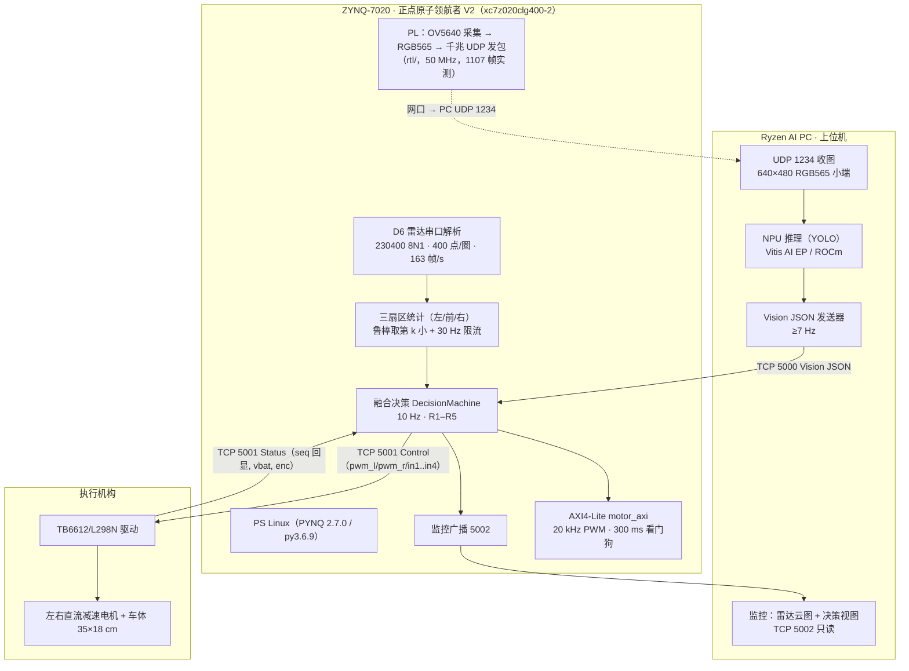

# 系统架构与数据流

> 对应指南 3.2.5.1(1)。本文件回答三件事：**谁算什么、数据怎么流、FPGA 为什么不可替代**。
> 代码入口：[`host/app/joint/board_main.py`](../host/app/joint/board_main.py)（板端唯一入口）。

---

## 1. 任务与硬约束

| 项 | 内容 | 出处 |
|---|---|---|
| 赛道 | 具身智能赛道（3.2）：Ryzen AI PC + FPGA/Zynq 异构协同，完成至少一项真实物理任务 | 指南 3.2.1 / 3.2.2 |
| 本队任务 | 室内移动机器人导航与避障：识别行人/障碍 → 减速、绕行或停车 | 指南 3.2.2.2 |
| 必须链路 | 感知 → 理解 → 决策 → 控制 → 执行，且闭环完整；机械可简化 | 指南 3.2.2.1 |
| 硬约束 1 | 上位机必须是 AMD RYZEN AI PC，AI PC 侧软件栈须 ROCm ≥ 7.14.0 并声明版本 | 指南 3.2.3.1 |
| 硬约束 2 | FPGA/Zynq 不能只当 USB/串口/GPIO 转接板 | 指南 3.2.2.1 / 3.2.3.3 |
| 硬约束 3 | 必须在真实硬件跑通，不接受纯仿真 | 指南 3.2.3.1 |

---

## 2. 总体架构

**一句话读法**：PL 只做「把相机画面变成网络包」；PS 里做「雷达解析 + 融合决策」；PC 做「看图想事」。三处分工的边界都落在**接口契约**上（[`docs/interface.md`](interface.md)），换任何一头的实现都不影响另外两头。

---

## 3. 计算单元划分依据（3.2.5.1(1) 要求写清「为什么这么分」）

| 功能 | 放在 | 为什么放这儿 | 反证（放别处会怎样） |
|---|---|---|---|
| YOLO 推理 | Ryzen AI PC | 模型会换、要迭代精度，工具链在 PC（ONNX/量化/Vitis AI EP）；PC 有 NPU/GPU 与内存余量 | 放 7020 要 HLS 重训/定点化，改一次模型两周 |
| 图像预处理（RGB565 解码、resize、归一化） | PC 侧 Python（收图线程与推理线程分离） | 与模型强耦合；PC 上 640×480 解码耗时远低于推理 | 放 PL 要占 BRAM 与 DSP，且无法跟着模型变 |
| OV5640 采集与打包 | PL（Verilog） | 像素流是硬实时、带宽稳定；DVP 时序必须硬件抓 | PS 用 GPIO 模拟 DVP 只能到几帧/秒 |
| 360° 雷达解析与三扇区统计 | PS（Python） | 串口 + 位打包解析，逻辑复杂但吞吐低（163 帧/s × 85 B ≈ 14 KB/s） | 放 PL 收益小（UART 解析不是瓶颈），调试成本高 |
| 融合决策（R1–R5） | PS（Python） | 规则要频繁调参、要打日志复现；10 Hz 对 Python 毫无压力（开发机实测 P99 = 101 ms，板端待复测） | 放 PL 每次改阈值都要综合一遍 |
| 电机 PWM + 方向引脚 | **PL（AXI 寄存器）** | 20 kHz 载波要求周期抖动 µs 级；软件定时器做不到，且 PS 挂了电机必须停 | 纯 Python 软件 PWM 抖动毫秒级，电机啸叫、低速爬行 |
| 安全急停（看门狗） | **PL（硬件）** | PS 崩溃/调度卡死时硬件必须自己停：300 ms 没收到心跳写 → 强制停车 | 软件看门狗在 PS 卡死时一起失效 |
| 监控展示 | PC（只读） | 板上无显示器，ARM 上 matplotlib 一帧 1–2 s | 板上画图会直接拖垮 10 Hz 决策 |

> 一句话：**PC 负责「想」，PL 负责「手」，PS 负责「判断该不该动手」**。FPGA 的价值不在算力，而在**确定性与安全兜底**（20 kHz PWM + 硬件看门狗 + 像素流接入）。

---

## 4. 数据流与时标

| 链路 | 传输 | 频率 | 数据量 | 时标口径 |
|---|---|---|---|---|
| 相机 → PC | UDP 1234（PL 直发） | 26 fps | 每帧 614 400 B 像素 + 8 B 头 | PC 收到即处理；丢帧不重传 |
| 雷达 → PS | UART 230400 8N1 | 163 帧/s（400 点/圈） | 85 B/帧 | PS 侧 `t = time.time()*1000` 打戳 |
| PC → PS 视觉 | TCP 5000，按行 JSON | **≥ 7 Hz（硬要求）** | ~120 B/行 | **板子不用 PC 的 timestamp，重打到达时间**（两侧时钟无需同步） |
| PS → 电机 | TCP 5001 Control JSON | 10 Hz | ~150 B/行 | `seq` 递增，Status 原样回显 |
| 电机 → PS | TCP 5001 Status JSON | 每帧回一条 | ~90 B/行 | 超过 500 ms 无 Status → 判链路断 → 强制 STOP |
| PS → PC 监控 | TCP 5002，按行 JSON | ~10 Hz | 点云 + 12 扇区 + 规则 | 只读，断连不影响决策 |

**为什么视觉要 ≥7 Hz**：`vision_timeout_ms = 300`，公式 `timeout ≥ 2 × (1000 / 频率)`。2 Hz 发送时 70 % 的决策周期都在停车，车一顿一顿走，看着像程序抽风。见 `host/app/integration/contract.py` 顶部注释。

---

## 5. 决策状态机（融合核心）

> 实现：[`host/app/car/fusion/machine.py`](../host/app/car/fusion/machine.py)。每次 `step()` 返回 `(control, rule_id, why)`，`rule_id` 进日志，可逐步复算。

| 规则 | 触发条件 | 动作 | 设计理由 |
|---|---|---|---|
| **R1** 双确认加险 | 视觉有障碍 **且** 雷达前向 < `danger_m` | STOP | 两个独立传感器都报警 → 必须停 |
| **R2** 视觉优先 | 视觉有障碍 **但** 雷达前向无回波 | 居中→STOP；侧向且置信度 ≥0.60 且连续 2 帧→转向；否则 SLOW | 「雷达没回波」不等于「没东西」（黑衣服、玻璃、低反射） |
| **R3** 雷达单源谨慎 | 视觉无障碍 **且** 雷达前向危险 | 连续 3 帧才 STOP，其间 SLOW | 单帧噪点不能直接刹死；也不能凭单次回波转向 |
| **R4** 转向决策 | 视觉/雷达给出侧向目标 | LEFT/RIGHT（两侧都堵 → STOP） | 方向 = 视觉目标方位 ∧ 左右可通行空间 |
| **R5** 失效即停 | `fault` / 雷达超时 / 视觉过期 / 从未收到 | STOP | **最高优先级**，宁可停不可撞 |

**阈值（`car/protocol.py::CFG`，改动须升 `CONTRACT_VERSION`）**

| 键 | 值 | 含义 |
|---|---|---|
| `danger_m` | 0.50 m | 前向危险距离 |
| `warn_m` | 1.20 m | 前向警惕距离 |
| `passable_m` | 0.60 m | 侧向可通行阈值 |
| `radar_timeout_ms` | 200 ms | 雷达无新帧判失效 |
| `vision_timeout_ms` | 300 ms | 视觉过期（对应视觉 ≥6.7 Hz） |
| `r3_confirm_frames` | 3 | R3 连续确认帧数 |
| `side_confirm_frames` | 2 | 侧向「堵死」确认帧数（只闪一帧不算） |
| `r2_confirm_frames` | 2 | R2 视觉单源转向确认帧数（停车不等确认） |
| `vision_single_conf` | 0.60 | 视觉单源允许转向的最低置信度 |
| 速度 | 前进 60 / 慢速 25 / 转向 35（0–100） | 经 `contract.py` 映射到 `pwm_l/pwm_r`（满量程 1000、`TURN_GAIN=0.6`） |

---

## 6. 异常处理与降级

| 故障 | 检测方式 | 系统行为 | 恢复 |
|---|---|---|---|
| 视觉断流 | 300 ms 无新帧 | R5 → STOP | 收到新帧自动恢复（无需重启） |
| 视觉发畸形帧 | `protocol.parse_vision()` 校验失败 | 丢弃该帧，按「本帧无视觉」处理 | 自动 |
| 雷达拔线/卡死 | 200 ms 无新帧 | R5 → STOP | 重新读到帧即恢复 |
| 控制链路断 | Status 超 500 ms / socket 异常 | 判链路断 → STOP；断线每 1 s 重连 | 自动重连 |
| 决策进程卡死 | PL 300 ms 未收到心跳写 | **硬件急停**（`motor_axi` 内部，PS 不参与） | 重新写心跳 + 清急停 |
| 监控端卡住 | 广播 socket 写失败 | 丢弃该客户端，不阻塞决策循环 | 重新连接 |
| 程序异常退出 | 进程结束即不再写心跳 | 300 ms 后硬件急停 | 重启进程 |

---

## 7. FPGA/Zynq 端承担的硬件功能（对应 3.2.4.3「可量化贡献」）

1. **像素流接入**：OV5640 DVP → RGB565 → UDP 打包（`rtl/` 18 个文件）。实测抓包 1107 帧、每帧 85 B 的雷达帧解析在同板上并行运行时不互相抢 CPU。
2. **确定性 PWM**：`motor_axi` 20 kHz 载波（50 MHz / 2500）。软件 PWM 抖动毫秒级，低速会爬行/啸叫。
3. **硬件看门狗**：300 ms 心跳超时强制停车 —— 这是「PS 死机也不撞人」的唯一保证，纯软件方案无法提供。
4. **AXI 寄存器接口**：把「速度」从 RTL 常量变成 PS 可写寄存器（`0x04/0x08`），标定无需重新综合。

**资源与时序（Vivado 2025.2，xc7z020clg400-2，`sys_clk` 50 MHz）**

| 项 | 数值 | 报告 |
|---|---|---|
| LUT | 1164 / 53200（2.19 %） | [`fpga/report/utilization_placed.rpt`](../fpga/report/utilization_placed.rpt) |
| FF | 1137 / 106400（1.07 %） | 同上 |
| BRAM | 0.5 tile（RAMB18 ×1，0.36 %） | 同上 |
| DSP | 0 | 同上 |
| WNS / WHS | **+1.096 ns / +0.087 ns**，约束全部满足 | [`fpga/report/timing_summary_routed.rpt`](../fpga/report/timing_summary_routed.rpt) |

> 资源占用低是**刻意**的：视觉加速与图像预处理留给 PC（模型会变），PL 只保留「必须确定性」的部分，留出后续加 AXI 外设与加速模块的余量。

---

## 8. 与指南要求的差距（必须补齐才提交）

| 要求 | 现状 | 补齐计划 |
|---|---|---|
| AI PC 侧软件栈 ROCm ≥ 7.14.0 + 版本声明 | onnxruntime 1.23.0 + Vitis AI EP（Ryzen AI 1.6.0） | 在 Ryzen AI PC 上装 ROCm，记录 `rocminfo`/`hipcc --version`；模型走 MIGraphX/ONNX Runtime ROCm EP；`docs/hardware_setup.md` 附版本表 |
| 视觉 JSON ≥ 7 Hz 接入 5000/TCP | 现有链路 0.5 s 一次（2 Hz） | 去掉推理节流、把 `main_ryzenai.py` 的输出改接 `VisionSender`（TCP 行 JSON），用 `vision_timeout_ms=300` 反向验频 |
| 端到端延迟 / 闭环成功率可复测 | 只有软件侧决策周期 | 逻辑分析仪打点（GPIO 翻转 ↔ PWM 上升沿）+ 场地 20 次任务试验表 |
| 结果回发 FPGA（`a5 0f f0 5a`） | PC 侧已发，PL 无解析模块 | 可选项：优先走 TCP 5000 契约，避免两套协议并存 |
| 真车闭环 | 假硬件验证 | 雷达 + 板 + 电机 + 场地联调，按 [`docs/joint_debug_manual.md`](joint_debug_manual.md) 九条验收 |

---

## 9. 已知风险

- **端口 5000 有两套互不兼容的实现**：`joint/vision_server.py`（TCP，当前方案）与 `integration/vision_receiver.py`（UDP，早期方案）。两者不能同时起。以 TCP 为准，UDP 那套仅作历史参考（建议改到 5010）——详见 [`docs/interface.md`](interface.md)。
- **板上 Python 3.6.9**：不能用 dataclass、海象运算符、PEP585 泛型；已有代码已扫描过，新增代码需自查。
- **雷达 0° 零点**：官方定义 0° 指向「单个安装耳」，不是接线束方向；装车偏角靠 `ZERO_OFFSET_DEG` 补偿，标定错会左右反。
